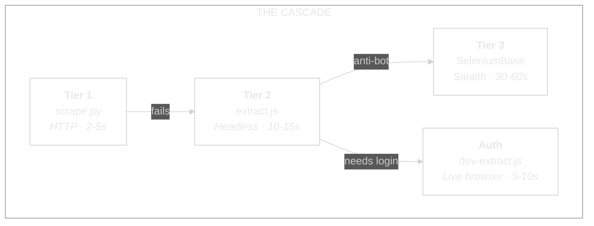
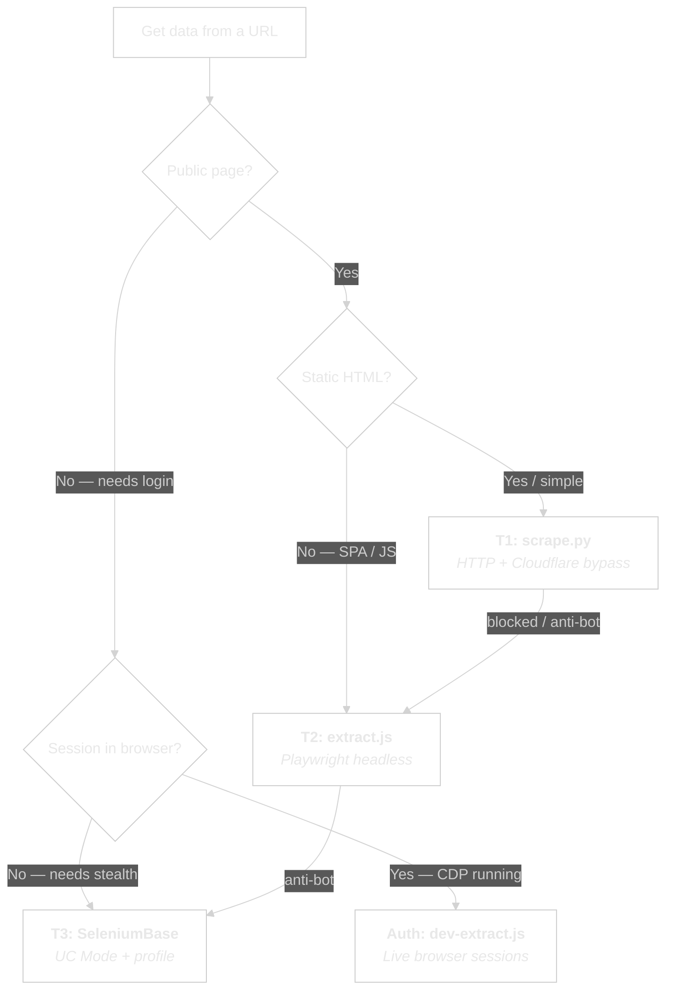
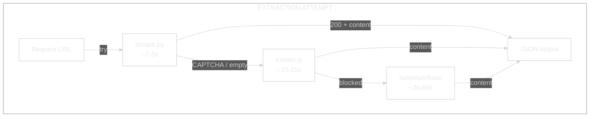

<picture>
  <source media="(prefers-color-scheme: dark)" srcset="assets/logo-dark.svg">
  <source media="(prefers-color-scheme: light)" srcset="assets/logo-light.svg">
  
</picture>

<br/>


**Extraction meets flow. 4 tiers, one interface.**
**The lightest tool that works. Auto-escalates when it doesn't.**

---

## Why This Exists

Three problems, one toolkit.

**Firecrawl is dead.** No credits, monthly plan inactive. Every call fails. It's been disabled.

**Playwright MCP burns tokens.** Interactive browser sessions cost 2,000-30,000 tokens per page. Navigate, wait, screenshot, read DOM, extract — each step is a round-trip. For a simple product page, that's $0.10-0.50 in tokens for data you could get with a 200-token HTTP request.

**SeleniumBase is heavy for simple pages.** UC Mode launches a full stealth browser with anti-detection. Powerful — but overkill for a blog post or a public product listing. 30-60 seconds where 2-5 seconds would do.

ExtractFlow solves this with a **cascade**: always start with the lightest tool. If it fails, flow down to the next tier. No manual routing. No token waste. No overkill.

---

## How It Works

Four tiers. Each one heavier, slower, and more capable than the last. The system picks the lightest tier that succeeds.



### Routing Decision Tree

Not sure which tier? Follow the tree.



### Quick Reference

| Task | Script | Tier | Speed |
|------|--------|------|-------|
| Public page content | `scrape.py` | T1 | ~2-5s |
| Cloudflare-protected page | `scrape.py` | T1 | ~2-5s |
| Structured tables | `scrape.py` | T1 | ~2-5s |
| SPA / JS-rendered page | `extract.js` | T2 | ~10-15s |
| Custom DOM + JS execution | `extract.js` | T2 | ~10-15s |
| localhost / file:// URLs | `extract.js` | T2 | ~10-15s |
| Batch scrape (3+ URLs) | `batch-extract.js` | T2 | ~10-15s |
| **Seller Central data** | **`dev-extract.js`** | **Auth** | **~5-10s** |
| **Any logged-in dashboard** | **`dev-extract.js`** | **Auth** | **~5-10s** |
| **Google Sheets interaction** | **`dev-extract.js`** | **Auth** | **~5-10s** |
| Amazon product pages | SeleniumBase template | T3 | ~30-60s |
| Anti-bot / login persist | SeleniumBase template | T3 | ~30-60s |

---

## Quick Start

### Installation

```bash
git clone git@github.com:sellersessions/extract-flow.git
cd extract-flow

# Node dependencies (Playwright + Chromium)
npm install

# Python dependencies (in a virtual environment)
python3 -m venv .venv
source .venv/bin/activate
pip install -r requirements.txt

# Optional: dev-browser for Auth tier
npm install -g dev-browser
dev-browser install
```

### Tier 1 — HTTP Extraction

Fast. No browser. Handles Cloudflare IUAM challenges via cloudscraper25.

```bash
# Basic extraction
python scripts/scrape.py --url https://example.com

# With CSS selectors
python scripts/scrape.py --url https://example.com --selectors '{"prices": ".price"}'

# Exclude elements
python scripts/scrape.py --url https://example.com --exclude "nav,footer"
```

### Tier 2 — Playwright Headless

Full browser. JS rendering. Cookie consent auto-dismiss. Lazy-load scroll.

```bash
# Single page
node scripts/extract.js --url https://example.com

# Wait for specific element
node scripts/extract.js --url https://example.com --wait-for ".content"

# Scroll for lazy-loaded content
node scripts/extract.js --url https://example.com --scroll

# Batch — multiple URLs
node scripts/batch-extract.js --urls "https://a.com,https://b.com,https://c.com"
node scripts/batch-extract.js --file urls.txt --concurrency 5 --delay 2000
```

### Auth Tier — Live Browser via CDP

Connects to your running browser. Has all your cookies, sessions, login state.

```bash
# Launch browser with CDP (first time)
bash scripts/launch-cdp.sh          # Comet
bash scripts/launch-cdp.sh chrome   # Chrome
bash scripts/launch-cdp.sh check    # Verify CDP is running

# Extract from authenticated page
node scripts/dev-extract.js --connect --url https://sellercentral.amazon.co.uk

# With custom selectors
node scripts/dev-extract.js --connect --url https://example.com --selectors '{"data": ".target"}'
```

### Tier 3 — SeleniumBase (Anti-Bot)

UC Mode stealth browser. For sites that block everything else.

```bash
# Copy and customise a template
cp templates/scrape_page.py scripts/generated/my_scrape.py
# Edit the === CUSTOMISE THESE === section
python scripts/generated/my_scrape.py
```

### Escalation Waterfall

What happens when a tier fails:



Every script returns **JSON to stdout** with a consistent shape:

```json
{
  "title": "Page Title",
  "url": "https://example.com",
  "meta": { "description": "..." },
  "content": "Extracted text content...",
  "links": [{ "text": "Link", "href": "/path" }],
  "tables": [{ "headers": [...], "rows": [...] }],
  "source": "cloudscraper|playwright|dev-browser",
  "fallback": "playwright|seleniumbase"
}
```

The `fallback` field tells you which tier to try next if this one failed.

---

## CLI Reference

### scrape.py (Tier 1)

| Flag | Description | Default |
|------|-------------|---------|
| `--url` | Target URL (required) | — |
| `--selectors` | JSON CSS selectors `'{"name": ".sel"}'` | — |
| `--exclude` | Elements to strip `"nav,footer"` | — |
| `--format` | Output: `json`, `text`, `markdown` | `json` |
| `--timeout` | Request timeout seconds | `15` |

### extract.js (Tier 2)

| Flag | Description | Default |
|------|-------------|---------|
| `--url` | Target URL (required) | — |
| `--selectors` | JSON CSS selectors | — |
| `--exclude` | Elements to strip | — |
| `--wait-for` | CSS selector to wait for | — |
| `--scroll` | Auto-scroll for lazy content | `false` |
| `--timeout` | Page timeout seconds | `15` |

### batch-extract.js (Tier 2)

| Flag | Description | Default |
|------|-------------|---------|
| `--urls` | Comma-separated URLs | — |
| `--file` | File with one URL per line | — |
| `--concurrency` | Parallel browsers | `3` |
| `--delay` | Delay between batches (ms) | `1000` |
| `--selectors` | JSON CSS selectors | — |
| `--exclude` | Elements to strip | — |
| `--scroll` | Auto-scroll | `false` |
| `--timeout` | Per-page timeout seconds | `15` |

### dev-extract.js (Auth)

| Flag | Description | Default |
|------|-------------|---------|
| `--url` | Target URL (required) | — |
| `--connect` | CDP URL (or empty for auto) | — |
| `--selectors` | JSON CSS selectors | — |
| `--exclude` | Elements to strip | — |
| `--wait-for` | CSS selector to wait for | — |
| `--scroll` | Auto-scroll | `false` |
| `--timeout` | Page timeout seconds | `20` |
| `--read-only` | Prevent form fills/clicks | `true` |

---

## Results & Edge Cases

### Token Savings

| Method | Tokens per page | Cost (Opus) |
|--------|----------------|-------------|
| Playwright MCP interactive | 2,000-30,000 | $0.10-0.50 |
| **ExtractFlow T1 (HTTP)** | **~200-500** | **~$0.01** |
| **ExtractFlow T2 (headless)** | **~200-500** | **~$0.01** |
| **ExtractFlow Auth (CDP)** | **~200-500** | **~$0.01** |

Scripts return structured JSON. Claude reads JSON. No screenshots, no DOM inspection, no back-and-forth.

### Real-World Tests

| Target | Tier | Result |
|--------|------|--------|
| Amazon PDP (.co.uk) | T1 fails → T2 | Title, price, features, BSR, browse nodes, GL |
| Airbnb account settings | Auth | Full profile, nav links, account details |
| WordPress wp-admin | Auth | Login redirect detected, `session_expired` signal |
| Example.com | T1 | Clean extraction in ~2s |

### Known Limitations

- **Amazon product pages** return CAPTCHA at T1 (expected — anti-bot). T2 works for public pages.
- **Item Type Keyword** and **Product Type** are SP-API only — not in page source at any tier.
- **Auth tier** requires browser relaunch with CDP flag (`launch-cdp.sh`). Sessions expire independently.
- **SeleniumBase T3** runs headed by default (set `SB_HEADLESS=true` for background).
- **50KB output cap** on all scripts to prevent context window overflow.

---

## Project Structure

```
extract-flow/
  ├── README.md
  ├── MASTER-LOG.md
  ├── CLAUDE.md
  ├── package.json
  ├── requirements.txt
  ├── assets/
  │   ├── logo-dark.svg
  │   └── logo-light.svg
  ├── scripts/
  │   ├── scrape.py              T1: HTTP extraction
  │   ├── extract.js             T2: Playwright headless
  │   ├── batch-extract.js       T2: Multi-URL concurrent
  │   ├── dev-extract.js         Auth: Live browser CDP
  │   ├── launch-cdp.sh          CDP launcher
  │   └── with_server.py         Server lifecycle
  ├── templates/                  SeleniumBase T3 templates
  │   ├── auth_flow.py
  │   ├── scrape_page.py
  │   ├── form_fill.py
  │   └── multi_page.py
  ├── examples/
  ├── docs/
  └── results/                    .gitignored output
```

---

## Dependencies

| Component | Version | Purpose |
|-----------|---------|---------|
| Node.js | >=18 | Runtime for T2 + Auth scripts |
| Python | >=3.10 | Runtime for T1 + T3 scripts |
| Playwright | ^1.50.0 | Headless browser (T2) |
| cloudscraper25 | >=2.7.0 | Cloudflare bypass (T1) |
| BeautifulSoup4 | >=4.12.0 | HTML parsing (T1) |
| SeleniumBase | >=4.20.0 | UC Mode anti-bot (T3) |
| dev-browser | 0.2.4 | CDP connector (Auth) |
| Chromium | via Playwright | Browser binary |
