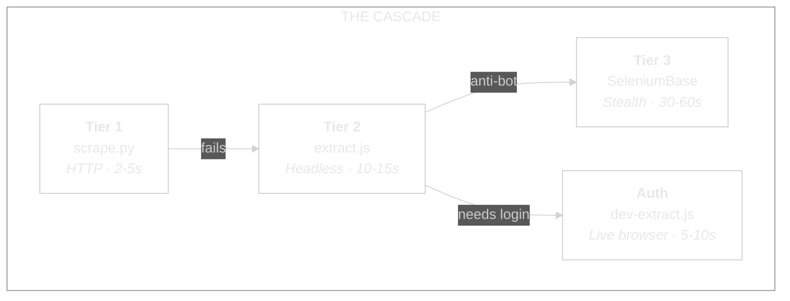
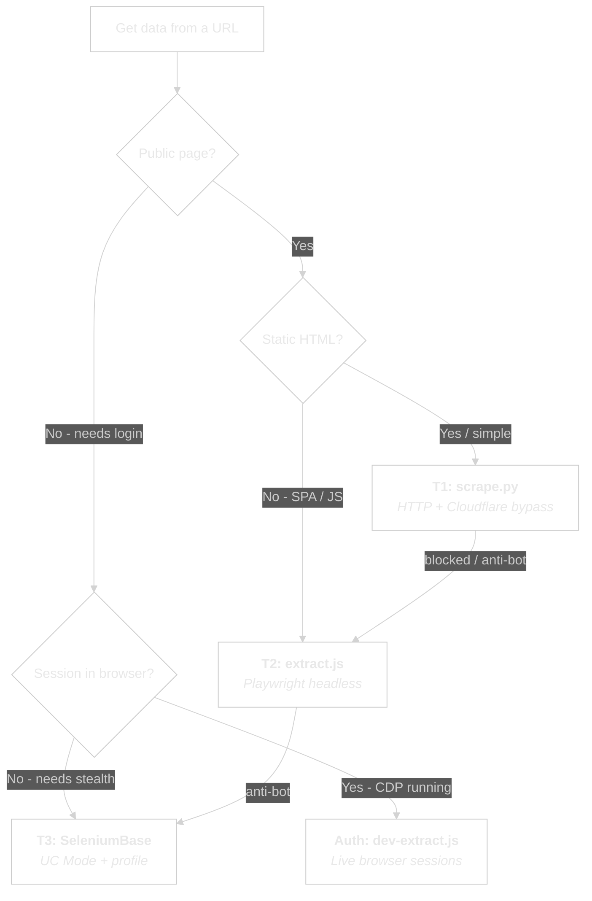
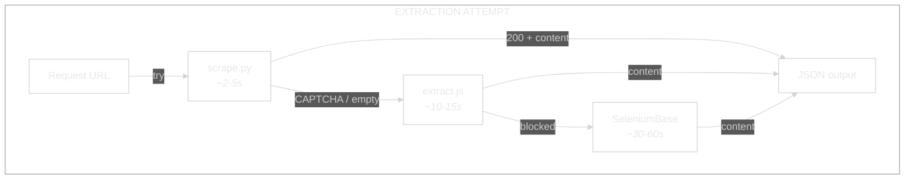

<picture>
  <source media="(prefers-color-scheme: dark)" srcset="assets/logo-dark.svg">
  <source media="(prefers-color-scheme: light)" srcset="assets/logo-light.svg">
  
</picture>

<br/>


**A Swiss Army knife for web extraction.**
**One command. Structured JSON. Any page on the internet.**

---

## Why This Exists

### The Playwright Problem

Playwright is powerful. But when you use it through an AI agent, it's also wasteful.

Every extraction becomes a conversation. Navigate to the page. Wait for it to load. Take a screenshot. Read the DOM. Find the selectors. Extract the data. Handle the error. Try again. Each step is a tool call. Each tool call costs tokens. A single product page can burn **2,000-30,000 tokens** - that's $0.10-0.50 per page just to read some text that a simple HTTP request could have grabbed in 200 tokens.

Multiply that across a project. Ten pages. Fifty pages. A batch of competitor listings. The token cost adds up fast, and the session takes minutes instead of seconds.

### The Subscription Problem

Services like Firecrawl solve part of this - but they come with monthly subscriptions, credit limits, and API rate caps. When your credits run out, every call fails silently. You're paying for something that works until it doesn't, with no fallback.

### The Overkill Problem

SeleniumBase UC Mode is the nuclear option - stealth browser, anti-detection, persistent profiles. It can get past almost anything. But launching a full stealth browser for a blog post or a public product listing is like driving a tank to the corner shop. 30-60 seconds where 2-5 would do.

### The Solution: A Cascade

ExtractFlow replaces all of this with a single principle: **use the lightest tool that works.**

Every extraction starts with a fast HTTP request. If that fails, it escalates to a headless browser. If that gets blocked, it moves to a stealth browser. If the page needs authentication, it connects to your live browser session. No manual routing. No subscriptions. No token waste. No overkill.

One command in, structured JSON out. Works on any URL - blogs, dashboards, SPAs, e-commerce, government portals, localhost dev servers. The script picks the right approach. You just pass the URL.

---

## How It's Different: Agentic Extraction

Standard browser automation tools - Playwright, Puppeteer, Selenium - are **interactive**. You write a script (or an AI writes one for you) that drives a browser step by step: go here, click that, wait, read this element, screenshot, parse. Every action is a separate instruction.

ExtractFlow is **agentic**. You give it a URL and tell it what you want. It figures out the rest.

```mermaid
%%{init: {'theme': 'dark', 'themeVariables': {'nodeTextColor': '#e8e8e8', 'primaryTextColor': '#e8e8e8', 'secondaryTextColor': '#cccccc', 'tertiaryTextColor': '#cccccc', 'clusterBkg': 'transparent', 'clusterBorder': '#8b949e'}}}%%

flowchart TD
    subgraph STANDARD[" STANDARD AUTOMATION "]
        direction LR
        S1["Navigate"] --> S2["Wait"]
        S2 --> S3["Screenshot"]
        S3 --> S4["Read DOM"]
        S4 --> S5["Extract"]
        S5 --> S6["Handle Error"]
        S6 --> S7["Retry"]
    end

    subgraph AGENTIC[" EXTRACTFLOW "]
        direction LR
        A1["URL in"] --> A2["JSON out"]
    end

    style S1 fill:none,stroke-width:1px,color:#e8e8e8
    style S2 fill:none,stroke-width:1px,color:#e8e8e8
    style S3 fill:none,stroke-width:1px,color:#e8e8e8
    style S4 fill:none,stroke-width:1px,color:#e8e8e8
    style S5 fill:none,stroke-width:1px,color:#e8e8e8
    style S6 fill:none,stroke-width:1px,color:#e8e8e8
    style S7 fill:none,stroke-width:1px,color:#e8e8e8
    style A1 fill:none,stroke-width:1px,color:#e8e8e8
    style A2 fill:none,stroke-width:1px,color:#e8e8e8
    style STANDARD fill:none,stroke-width:1px,color:#e8e8e8
    style AGENTIC fill:none,stroke-width:1px,color:#e8e8e8
```



**What happens inside that arrow:**

1. **Auto-selects the right tier** - HTTP for simple pages, headless browser for SPAs, stealth browser for anti-bot sites, live browser for authenticated pages
2. **Handles failures automatically** - blocked at one tier? The script signals which tier to try next
3. **Dismisses cookie banners** - OneTrust, CookieBot, generic consent dialogs
4. **Auto-scrolls lazy content** - infinite scroll pages, deferred images
5. **Detects login redirects** - returns `session_expired` instead of garbage HTML
6. **Truncates to 50KB** - prevents context window overflow in AI agents
7. **Returns structured JSON** - title, content, links, tables, metadata. Ready for the next step in your pipeline

The difference for an AI agent is dramatic. Instead of 5-15 tool calls per page (navigate, wait, screenshot, read, extract, handle error), it's **one call**. Instead of 2,000-30,000 tokens, it's **200-500 tokens**. Instead of back-and-forth conversation, it's **fire and forget**.

| | Standard Playwright | ExtractFlow |
|---|---|---|
| Tool calls per page | 5-15 | 1 |
| Tokens per page | 2,000-30,000 | 200-500 |
| Cost per page (Opus) | $0.10-0.50 | ~$0.01 |
| Monthly subscription | Firecrawl: $19-99/mo | $0 |
| Anti-bot bypass | Manual scripting | Auto-escalation |
| Auth page access | Build a login flow | Connect to your browser |

---

## The Four Tiers



| Tier | Script | What It Does | Speed | When To Use |
|------|--------|-------------|-------|-------------|
| **T1** | `scrape.py` | Pure HTTP with Cloudflare IUAM bypass. No browser. | 2-5s | Blog posts, news articles, public APIs, documentation, any server-rendered page |
| **T2** | `extract.js` | Headless Chromium via Playwright. Full JS rendering. | 10-15s | SPAs, React/Vue/Angular apps, JS-heavy pages, lazy-loaded content, localhost |
| **T2** | `batch-extract.js` | Same as above, but concurrent. Multiple URLs at once. | 10-15s | Competitor analysis, price monitoring, bulk content extraction |
| **Auth** | `dev-extract.js` | Connects to your running browser via CDP. Your sessions, your cookies. | 5-10s | Seller Central, WordPress admin, Xero, Google Sheets, any logged-in dashboard |
| **T3** | SeleniumBase templates | Stealth browser with UC Mode anti-detection. | 30-60s | Amazon, Airbnb, banking portals, sites with DataDome/PerimeterX/Cloudflare Bot Management |

### Routing Decision Tree



---

## Real-World Examples

ExtractFlow handles anything with a URL. Here's what it looks like across different domains.

### E-Commerce: Amazon Product Data

Amazon blocks HTTP scraping with CAPTCHA - T1 fails, T2 handles it.

```bash
node scripts/extract.js --url "https://www.amazon.co.uk/dp/B0BZHMMVLG" --scroll
```

Returns: title, price, features, BSR, browse node path, GL (product group). All in one JSON response.

### SaaS Dashboards: Seller Central, Xero, Google Sheets

Connect to your live browser. Extract from any page you're logged into.

```bash
bash scripts/launch-cdp.sh                    # Launch browser with CDP
node scripts/dev-extract.js --connect --url https://sellercentral.amazon.co.uk
node scripts/dev-extract.js --connect --url https://go.xero.com/Dashboard
node scripts/dev-extract.js --connect --url https://docs.google.com/spreadsheets/d/...
```

No login flows. No cookie management. No credential storage. It uses the sessions already in your browser.

### CMS Platforms: WordPress Admin

```bash
node scripts/dev-extract.js --connect --url https://sellersessions.com/wp-admin/
```

If your session has expired, ExtractFlow detects the login redirect and returns `{"error": "session_expired"}` instead of garbage HTML. Log in manually, retry.

### Travel & Hospitality: Airbnb

Public listings need stealth (T3). But your own account settings? Auth tier handles it in 5 seconds.

```bash
# Your account data (Auth tier - instant)
node scripts/dev-extract.js --connect --url https://www.airbnb.com/account-settings

# Public listing (T3 - stealth needed)
python templates/scrape_page.py  # Customise for the listing URL
```

### Content & Research: Blogs, News, Documentation

Most content sites are simple - T1 grabs them in 2-5 seconds with no browser at all.

```bash
python scripts/scrape.py --url https://techcrunch.com/some-article
python scripts/scrape.py --url https://docs.python.org/3/library/json.html
python scripts/scrape.py --url https://en.wikipedia.org/wiki/Web_scraping
```

### Batch Jobs: Competitor Monitoring, Price Tracking

Extract from dozens of URLs concurrently.

```bash
# From a list
node scripts/batch-extract.js --urls "https://site1.com,https://site2.com,https://site3.com"

# From a file (one URL per line)
node scripts/batch-extract.js --file competitor-urls.txt --concurrency 5 --delay 2000
```

Output is JSONL - one JSON object per line, pipe it to `jq` or feed it into your next workflow.

### Local Development: Localhost & file:// URLs

Testing a local webapp? T2 handles localhost and file:// URLs.

```bash
node scripts/extract.js --url http://localhost:3000
node scripts/extract.js --url file:///Users/you/project/index.html
```

### Government & Legal Portals

Behind login + anti-bot? SeleniumBase with a persistent profile.

```bash
cp templates/auth_flow.py scripts/generated/court_portal.py
# Edit credentials and URL in the CUSTOMISE section
python scripts/generated/court_portal.py
```

---

## Quick Start

### Installation

```bash
git clone git@github.com:sellersessions/extract-flow.git
cd extract-flow

# Node dependencies (Playwright + Chromium)
npm install

# Python dependencies (in a virtual environment)
python3 -m venv .venv
source .venv/bin/activate
pip install -r requirements.txt

# Optional: dev-browser for Auth tier
npm install -g dev-browser
dev-browser install
```

### Your First Extraction

```bash
# Simplest possible extraction - T1, pure HTTP, ~2 seconds
python scripts/scrape.py --url https://example.com

# A JS-heavy page - T2, headless browser, ~10 seconds
node scripts/extract.js --url https://example.com --scroll

# An authenticated page - Auth tier, your live browser
bash scripts/launch-cdp.sh
node scripts/dev-extract.js --connect --url https://your-dashboard.com
```

### Escalation Waterfall

What happens when a tier fails:



Every script returns **JSON to stdout** with a consistent shape:

```json
{
  "title": "Page Title",
  "url": "https://example.com",
  "meta": { "description": "..." },
  "content": "Extracted text content...",
  "links": [{ "text": "Link", "href": "/path" }],
  "tables": [{ "headers": [...], "rows": [...] }],
  "source": "cloudscraper|playwright|dev-browser",
  "fallback": "playwright|seleniumbase"
}
```

The `fallback` field tells you which tier to try next if this one failed.

---

## CLI Reference

### scrape.py (Tier 1)

| Flag | Description | Default |
|------|-------------|---------|
| `--url` | Target URL (required) | - |
| `--selectors` | JSON CSS selectors `'{"name": ".sel"}'` | - |
| `--exclude` | Elements to strip `"nav,footer"` | - |
| `--format` | Output: `json`, `text`, `markdown` | `json` |
| `--timeout` | Request timeout seconds | `15` |

### extract.js (Tier 2)

| Flag | Description | Default |
|------|-------------|---------|
| `--url` | Target URL (required) | - |
| `--selectors` | JSON CSS selectors | - |
| `--exclude` | Elements to strip | - |
| `--wait-for` | CSS selector to wait for | - |
| `--scroll` | Auto-scroll for lazy content | `false` |
| `--timeout` | Page timeout seconds | `15` |

### batch-extract.js (Tier 2)

| Flag | Description | Default |
|------|-------------|---------|
| `--urls` | Comma-separated URLs | - |
| `--file` | File with one URL per line | - |
| `--concurrency` | Parallel browsers | `3` |
| `--delay` | Delay between batches (ms) | `1000` |
| `--selectors` | JSON CSS selectors | - |
| `--exclude` | Elements to strip | - |
| `--scroll` | Auto-scroll | `false` |
| `--timeout` | Per-page timeout seconds | `15` |

### dev-extract.js (Auth)

| Flag | Description | Default |
|------|-------------|---------|
| `--url` | Target URL (required) | - |
| `--connect` | CDP URL (or empty for auto) | - |
| `--selectors` | JSON CSS selectors | - |
| `--exclude` | Elements to strip | - |
| `--wait-for` | CSS selector to wait for | - |
| `--scroll` | Auto-scroll | `false` |
| `--timeout` | Page timeout seconds | `20` |
| `--read-only` | Prevent form fills/clicks | `true` |

---

## Known Limitations

- **Anti-bot sites** (Amazon, Airbnb public listings, banking) block T1 and sometimes T2. That's what T3 is for.
- **Auth tier needs CDP** - your browser must be relaunched with `launch-cdp.sh`. Sessions expire independently.
- **50KB output cap** on all scripts to prevent context window overflow in AI agents.
- **SeleniumBase T3** runs headed by default. Set `SB_HEADLESS=true` for background runs.
- **Not a crawler.** ExtractFlow extracts data from URLs you give it. It doesn't discover or follow links automatically.

---

## Project Structure

```
extract-flow/
  ├── README.md
  ├── MASTER-LOG.md
  ├── CLAUDE.md
  ├── package.json
  ├── requirements.txt
  ├── assets/
  │   ├── logo-dark.svg
  │   └── logo-light.svg
  ├── scripts/
  │   ├── scrape.py              T1: HTTP extraction
  │   ├── extract.js             T2: Playwright headless
  │   ├── batch-extract.js       T2: Multi-URL concurrent
  │   ├── dev-extract.js         Auth: Live browser CDP
  │   ├── launch-cdp.sh          CDP launcher
  │   └── with_server.py         Server lifecycle
  ├── templates/                  SeleniumBase T3 templates
  │   ├── auth_flow.py
  │   ├── scrape_page.py
  │   ├── form_fill.py
  │   └── multi_page.py
  ├── examples/
  ├── docs/
  └── results/                    .gitignored output
```

---

## Dependencies

| Component | Version | Purpose |
|-----------|---------|---------|
| Node.js | >=18 | Runtime for T2 + Auth scripts |
| Python | >=3.10 | Runtime for T1 + T3 scripts |
| Playwright | ^1.50.0 | Headless browser (T2) |
| cloudscraper25 | >=2.7.0 | Cloudflare bypass (T1) |
| BeautifulSoup4 | >=4.12.0 | HTML parsing (T1) |
| SeleniumBase | >=4.20.0 | UC Mode anti-bot (T3) |
| dev-browser | 0.2.4 | CDP connector (Auth) |
| Chromium | via Playwright | Browser binary |
