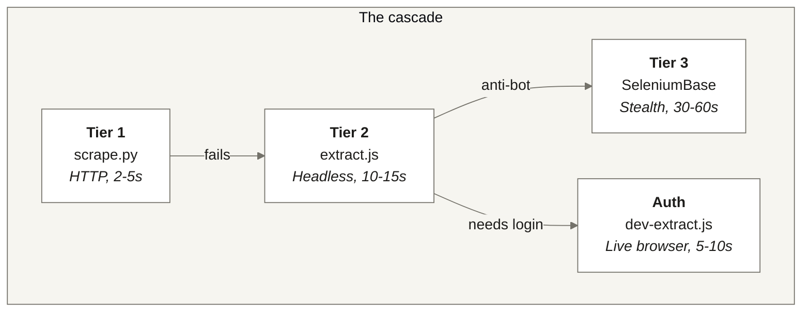
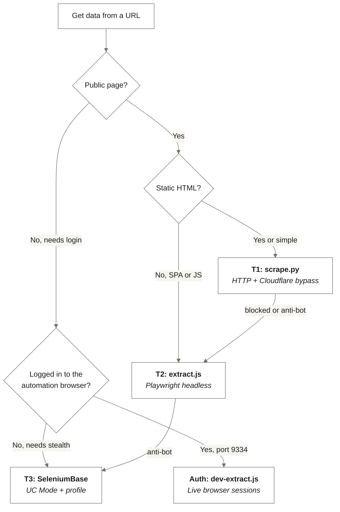
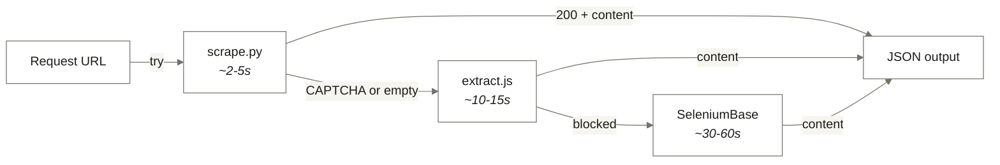

<picture>
  <source media="(prefers-color-scheme: dark)" srcset="assets/logo-dark.svg">
  <source media="(prefers-color-scheme: light)" srcset="assets/logo-light.svg">
  
</picture>

<br/>


**A Swiss Army knife for web extraction.**
**One command. Structured JSON. Any page on the internet.**

> [!NOTE]
> **TL;DR.** Pass a URL to one script and get structured JSON back: title, text, links, tables and metadata. It starts with a plain HTTP request and only steps up to a headless browser, a stealth browser or your own logged-in browser when the lighter tool fails, so an AI agent spends one tool call and a few hundred tokens per page instead of thousands.

[](#quick-start)
[](#test-protocol)
[](#companion-repos)

> [!TIP]
> **New here?** Start with the routing guide ([docs/02-ROUTING.md](docs/02-ROUTING.md)), which tells you which tier to reach for. If you only run one command, run the tier 1 line in [Quick Start](#quick-start).

---

## Why this exists

### The Playwright Problem

Playwright is powerful. But when you use it through an AI agent, it's also wasteful.

Every extraction becomes a conversation. Navigate to the page. Wait for it to load. Take a screenshot. Read the DOM. Find the selectors. Extract the data. Handle the error. Try again. Each step is a tool call. Each tool call costs tokens. A single product page can burn **2,000-30,000 tokens** - that's $0.10-0.50 per page just to read some text that a simple HTTP request could have grabbed in 200 tokens.

Multiply that across a project. Ten pages. Fifty pages. A batch of competitor listings. The token cost adds up fast, and the session takes minutes instead of seconds.

### The Subscription Problem

Services like Firecrawl solve part of this - but they come with monthly subscriptions, credit limits, and API rate caps. When your credits run out, every call fails silently. You're paying for something that works until it doesn't, with no fallback.

### The Overkill Problem

SeleniumBase UC Mode is the nuclear option - stealth browser, anti-detection, persistent profiles. It can get past almost anything. But launching a full stealth browser for a blog post or a public product listing is like driving a tank to the corner shop. 30-60 seconds where 2-5 would do.

### The Solution: A Cascade

ExtractFlow replaces all of this with a single principle: **use the lightest tool that works.**

Every extraction starts with a fast HTTP request. If that fails, it escalates to a headless browser. If that gets blocked, it moves to a stealth browser. If the page needs authentication, it connects to your live browser session. No manual routing. No subscriptions. No token waste. No overkill.

One command in, structured JSON out. Works on any URL - blogs, dashboards, SPAs, e-commerce, government portals, localhost dev servers. The script picks the right approach. You just pass the URL.

---

## ExtractFlow vs Playwright through an agent / Firecrawl

| Dimension | Playwright driven by an agent | Firecrawl | ExtractFlow |
|---|---|---|---|
| **Tool calls per page** | 5-15 | 1 | 1 |
| **Tokens per page** | 2,000-30,000 | Depends on the response size | 200-500 |
| **Cost per page (Opus)** | $0.10-0.50 | Credits on a plan | About $0.01 |
| **Monthly subscription** | $0 | $19-99 a month | $0 |
| **When the service is down or out of credits** | Not applicable | Every call fails | Runs locally, no credits |
| **Anti-bot sites** | Manual scripting | Handled by the service | Steps up to the stealth tier |
| **Logged-in pages** | Build a login flow | Not your sessions | Connects to a browser you are already logged in to |
| **Licence** | Apache 2.0 | Commercial service | MIT |

---

## What it does

Standard browser automation tools - Playwright, Puppeteer, Selenium - are **interactive**. You write a script (or an AI writes one for you) that drives a browser step by step: go here, click that, wait, read this element, screenshot, parse. Every action is a separate instruction.

ExtractFlow is **agentic**. You give it a URL and tell it what you want. It figures out the rest.

```mermaid
%%{init: {'theme': 'base', 'themeVariables': {'primaryColor': '#ffffff', 'primaryTextColor': '#1d1c1a', 'primaryBorderColor': '#74726a', 'lineColor': '#74726a', 'secondaryColor': '#f6f5f0', 'tertiaryColor': '#f6f5f0', 'clusterBkg': '#f6f5f0', 'clusterBorder': '#74726a'}}}%%
graph TD
    subgraph STANDARD["Standard automation: one tool call per action"]
        direction LR
        S1["Navigate"] --> S2["Wait"]
        S2 --> S3["Screenshot"]
        S3 --> S4["Read DOM"]
        S4 --> S5["Extract"]
        S5 --> S6["Handle error"]
        S6 --> S7["Retry"]
    end

    subgraph AGENTIC["ExtractFlow: one tool call per page"]
        direction LR
        A1["URL in"] --> A2["JSON out"]
    end

    style S1 fill:#ffffff,stroke:#74726a,stroke-width:1px,color:#1d1c1a
    style S2 fill:#ffffff,stroke:#74726a,stroke-width:1px,color:#1d1c1a
    style S3 fill:#ffffff,stroke:#74726a,stroke-width:1px,color:#1d1c1a
    style S4 fill:#ffffff,stroke:#74726a,stroke-width:1px,color:#1d1c1a
    style S5 fill:#ffffff,stroke:#74726a,stroke-width:1px,color:#1d1c1a
    style S6 fill:#ffffff,stroke:#74726a,stroke-width:1px,color:#1d1c1a
    style S7 fill:#ffffff,stroke:#74726a,stroke-width:1px,color:#1d1c1a
    style A1 fill:#ffffff,stroke:#74726a,stroke-width:1px,color:#1d1c1a
    style A2 fill:#ffffff,stroke:#74726a,stroke-width:1px,color:#1d1c1a
```



**What happens inside that arrow:**

1. **Auto-selects the right tier** - HTTP for simple pages, headless browser for SPAs, stealth browser for anti-bot sites, live browser for authenticated pages
2. **Handles failures automatically** - blocked at one tier? The script signals which tier to try next
3. **Dismisses cookie banners** - OneTrust, CookieBot, generic consent dialogs
4. **Auto-scrolls lazy content** - infinite scroll pages, deferred images
5. **Detects login redirects** - returns `session_expired` instead of garbage HTML
6. **Truncates to 50KB** - prevents context window overflow in AI agents
7. **Returns structured JSON** - title, content, links, tables, metadata. Ready for the next step in your pipeline

The difference for an AI agent is dramatic. Instead of 5-15 tool calls per page (navigate, wait, screenshot, read, extract, handle error), it's **one call**. Instead of 2,000-30,000 tokens, it's **200-500 tokens**. Instead of back-and-forth conversation, it's **fire and forget**.

### How the parts connect

Four tiers, lightest first. Each script is one tier; the escalation is a signal in the JSON (`fallback`), so the caller, usually an AI agent, knows which script to run next.



<sub>Tier 1 and tier 2 need no browser session. The auth tier connects to the dedicated automation browser on port 9334, never to your everyday browser. Tier 3 runs from the templates in <code>templates/</code>.</sub>

| Tier | Script | What It Does | Speed | When To Use |
|------|--------|-------------|-------|-------------|
| **T1** | `scrape.py` | Pure HTTP with Cloudflare IUAM bypass. No browser. | 2-5s | Blog posts, news articles, public APIs, documentation, any server-rendered page |
| **T2** | `extract.js` | Headless Chromium via Playwright. Full JS rendering. | 10-15s | SPAs, React/Vue/Angular apps, JS-heavy pages, lazy-loaded content, localhost |
| **T2** | `batch-extract.js` | Same as above, but concurrent. Multiple URLs at once. | 10-15s | Competitor analysis, price monitoring, bulk content extraction |
| **Auth** | `dev-extract.js` | Connects to the automation browser via CDP on port 9334. Your sessions, your cookies. | 5-10s | Seller Central, WordPress admin, Xero, Google Sheets, any logged-in dashboard |
| **T3** | SeleniumBase templates | Stealth browser with UC Mode anti-detection. | 30-60s | Amazon, Airbnb, banking portals, sites with DataDome/PerimeterX/Cloudflare Bot Management |

#### Routing decision tree



---

## Quick Start

```bash
git clone https://github.com/sellersessions/extract-flow.git
cd extract-flow

# Node dependencies (Playwright, its Chromium, and marked for the PDF tool)
npm install

# Python dependencies (in a virtual environment)
python3 -m venv .venv
source .venv/bin/activate
pip install -r requirements.txt

# Optional: dev-browser for the auth tier
npm install -g dev-browser
dev-browser install
```

### Your first extraction

```bash
# Simplest possible extraction - T1, pure HTTP, ~2 seconds
python scripts/scrape.py --url https://example.com

# A JS-heavy page - T2, headless browser, ~10 seconds
node scripts/extract.js --url https://example.com --scroll

# A logged-in page - auth tier, the dedicated automation browser on port 9334
./scripts/launch-automation-browser.sh
node scripts/dev-extract.js --url https://your-dashboard.com --connect http://localhost:9334
```

The first launch of the automation browser opens an empty Chromium window with its own profile. Log in to each service once; the cookies stay in that profile for later runs. It is a separate browser from the one you work in, so an extraction never takes over your screen.

### Escalation waterfall

What happens when a tier fails:



Every script returns **JSON to stdout**. A successful extraction looks like this (`extract.js` also adds the HTTP `status`; `dev-extract.js` adds `"source": "dev-browser"`):

```json
{
  "url": "https://example.com",
  "title": "Page Title",
  "meta": { "description": "..." },
  "content": "Extracted text content...",
  "links": [{ "text": "Link", "href": "/path" }],
  "tables": [{ "headers": ["..."], "rows": [["..."]] }]
}
```

A failed extraction carries a `fallback` field naming the tier to try next:

```json
{ "fallback": "playwright", "error": "...", "url": "https://example.com" }
```

---

## Test protocol

Run this once after installing, before you trust ExtractFlow with real work. It takes about five minutes. Checks 1 and 2 were run on 25 Oct 2026 and passed.

| # | Check | How | Pass looks like |
|---|---|---|---|
| 1 | Tier 1 works without a browser | `python scripts/scrape.py --url https://example.com` | JSON with `"title": "Example Domain"` and no `fallback` field |
| 2 | Tier 2 renders a page | `node scripts/extract.js --url https://example.com` | JSON with `"status": 200` and `"title": "Example Domain"` |
| 3 | The automation browser is up on its own port | `./scripts/launch-automation-browser.sh check` | `Automation browser running on port 9334`. If it says `NOT running`, launch it without `check` and run this again |
| 4 | Nothing you extracted can reach git | After any run that saved output, `git status --short results/` | Prints nothing. Everything under `results/` except `.gitkeep` is ignored |

**Step 5. Give it a real job.**

```
Extract the title, the text and every link from https://docs.python.org/3/library/json.html.
Start at tier 1 and only step up a tier if the JSON comes back with a fallback field.
Tell me which tier answered and how many links you found.
```

Grade it on these, not on whether it felt right:

- **Pass:** tier 1 answered on the first call, the title mentions `json`, and the link count is above zero.
- **Partial:** the right content came back, but the agent started at tier 2 or tier 3, or made more than two tool calls. The tool worked; the routing did not. Point the agent at [docs/02-ROUTING.md](docs/02-ROUTING.md).
- **Fail:** no JSON, an empty `content` field, or an error with no `fallback`. Check [docs/04-TROUBLESHOOTING.md](docs/04-TROUBLESHOOTING.md) and re-run checks 1 and 2.

The auth tier reads pages from sessions you are logged in to, so it is read-only by default: `dev-extract.js` never fills forms or clicks buttons unless you pass `--read-only false`.

---

## See it in action: real-world examples

ExtractFlow handles anything with a URL. Here's what it looks like across different domains.

### E-Commerce: Amazon Product Data

Amazon blocks HTTP scraping with CAPTCHA - T1 fails, T2 handles it.

```bash
node scripts/extract.js --url "https://www.amazon.co.uk/dp/B0BZHMMVLG" --scroll
```

Returns: title, price, features, BSR, browse node path, GL (product group). All in one JSON response.

### SaaS Dashboards: Seller Central, Xero, Google Sheets

Connect to the automation browser. Extract from any page you're logged into there.

```bash
./scripts/launch-automation-browser.sh        # Launch the automation browser on port 9334
node scripts/dev-extract.js --connect http://localhost:9334 --url https://sellercentral.amazon.co.uk
node scripts/dev-extract.js --connect http://localhost:9334 --url https://go.xero.com/Dashboard
node scripts/dev-extract.js --connect http://localhost:9334 --url https://docs.google.com/spreadsheets/d/...
```

No login flows. No cookie management. No credential storage. It uses the sessions already in that browser's profile.

### CMS Platforms: WordPress Admin

```bash
node scripts/dev-extract.js --connect http://localhost:9334 --url https://sellersessions.com/wp-admin/
```

If your session has expired, ExtractFlow detects the login redirect and returns `{"error": "session_expired"}` instead of garbage HTML. Log in manually, retry.

### Travel & Hospitality: Airbnb

Public listings need stealth (T3). But your own account settings? Auth tier handles it in 5 seconds.

```bash
# Your account data (Auth tier - instant)
node scripts/dev-extract.js --connect http://localhost:9334 --url https://www.airbnb.com/account-settings

# Public listing (T3 - stealth needed)
python templates/scrape_page.py  # Customise for the listing URL
```

### Content & Research: Blogs, News, Documentation

Most content sites are simple - T1 grabs them in 2-5 seconds with no browser at all.

```bash
python scripts/scrape.py --url https://techcrunch.com/some-article
python scripts/scrape.py --url https://docs.python.org/3/library/json.html
python scripts/scrape.py --url https://en.wikipedia.org/wiki/Web_scraping
```

### Batch Jobs: Competitor Monitoring, Price Tracking

Extract from dozens of URLs concurrently.

```bash
# From a list
node scripts/batch-extract.js --urls "https://site1.com,https://site2.com,https://site3.com"

# From a file (one URL per line)
node scripts/batch-extract.js --file competitor-urls.txt --concurrency 5 --delay 2000
```

Output is JSONL - one JSON object per line, pipe it to `jq` or feed it into your next workflow.

### Local Development: Localhost & file:// URLs

Testing a local webapp? T2 handles localhost and file:// URLs.

```bash
node scripts/extract.js --url http://localhost:3000
node scripts/extract.js --url file:///Users/you/project/index.html
```

### Government & Legal Portals

Behind login + anti-bot? SeleniumBase with a persistent profile.

```bash
mkdir -p scripts/generated
cp templates/auth_flow.py scripts/generated/court_portal.py
# Edit credentials and URL in the CUSTOMISE section
python scripts/generated/court_portal.py
```

---

## Architecture / Code reference

<details>
<summary><b>The automation browser (port 9334)</b>: logged-in extractions without taking over the browser you work in</summary>

<br/>

**WHY.** Attaching to your everyday browser over CDP moves its tabs and steals focus while you are trying to work. The auth tier needs a logged-in session, but not yours in the window you are using.

**WHAT.** `scripts/launch-automation-browser.sh` starts Playwright's bundled Chromium as a separate browser on CDP port 9334, with its own persistent profile at `~/.extract-flow/automation-profile/`. `scripts/launch-cdp.sh` is the older launcher: it relaunches your own Comet or Chrome on port 9222 and is kept only for the rare extraction that needs that personal session.

**HOW.**

```bash
./scripts/launch-automation-browser.sh check || ./scripts/launch-automation-browser.sh
node scripts/dev-extract.js --url https://example.com/account --connect http://localhost:9334
./scripts/launch-automation-browser.sh stop
```

**WHAT IF.** On macOS, put the window on its own desktop once (right-click the dock icon, Options, Assign To, This Desktop) and later launches land there. If a page returns `session_expired`, log in again inside the automation browser; the profile keeps the new cookies.

</details>

<details>
<summary><b>Utilities (inspect.js, md-to-pdf-batch.mjs, the Gmail scripts, with_server.py)</b>: the scripts that sit beside the four tiers</summary>

<br/>

**WHY.** Some jobs are not one-shot extractions: checking a page you just changed, turning a folder of markdown into PDFs, or reading mail threads through the automation browser.

**WHAT.**

| Script | What it does | Browser |
|---|---|---|
| `scripts/inspect.js` | Keeps a browser alive between calls for verification work: navigate, screenshot, eval, click, hover, scroll, resize, snapshot. Used by sister projects to capture evidence after a UI change | Its own Chromium on CDP port 9333 |
| `scripts/md-to-pdf-batch.mjs` | Converts every `.md` file under a folder to a `.pdf` beside it, using `marked` and Chromium print emulation. The markdown files are left untouched | Headless Chromium |
| `scripts/gmail-inbox-survey.js` | Lists the Gmail threads that match a search, without opening them | Automation browser, port 9334 |
| `scripts/gmail-thread-pull.js` | Opens the thread whose subject matches a snippet and saves it as JSON | Automation browser, port 9334 |
| `scripts/with_server.py` | Starts one or more local servers, runs a command against them, then shuts them down | None |

**HOW.**

```bash
node scripts/inspect.js start --viewport 1440x900
node scripts/inspect.js navigate http://localhost:3000
node scripts/inspect.js screenshot --path _captures/my-feature/after.png
node scripts/inspect.js stop

node scripts/md-to-pdf-batch.mjs "/path/to/folder"
node scripts/gmail-inbox-survey.js "is:unread"
node scripts/gmail-thread-pull.js "Subject snippet" results/thread.json
```

**WHAT IF.** The Gmail scripts need you to be logged in to Gmail inside the automation browser first. `inspect.js` runs on 9333 so it never collides with the auth tier on 9334.

</details>

<details>
<summary><b>CLI reference (scrape.py, extract.js, batch-extract.js, dev-extract.js)</b>: every flag for the four tier scripts</summary>

<br/>

### scrape.py (Tier 1)

| Flag | Description | Default |
|------|-------------|---------|
| `--url` | Target URL (required) | - |
| `--selectors` | JSON CSS selectors `'{"name": ".sel"}'` | - |
| `--exclude` | Elements to strip `"nav,footer"` | - |
| `--format` | Output: `json`, `text`, `markdown` | `json` |
| `--timeout` | Request timeout seconds | `15` |

### extract.js (Tier 2)

| Flag | Description | Default |
|------|-------------|---------|
| `--url` | Target URL (required) | - |
| `--selectors` | JSON CSS selectors | - |
| `--exclude` | Elements to strip | - |
| `--wait-for` | CSS selector to wait for | - |
| `--scroll` | Auto-scroll for lazy content | `false` |
| `--timeout` | Page timeout seconds | `15` |

### batch-extract.js (Tier 2)

| Flag | Description | Default |
|------|-------------|---------|
| `--urls` | Comma-separated URLs | - |
| `--file` | File with one URL per line | - |
| `--concurrency` | Parallel browsers | `3` |
| `--delay` | Delay between batches (ms) | `1000` |
| `--selectors` | JSON CSS selectors | - |
| `--exclude` | Elements to strip | - |
| `--scroll` | Auto-scroll | `false` |
| `--timeout` | Per-page timeout seconds | `15` |

### dev-extract.js (Auth)

| Flag | Description | Default |
|------|-------------|---------|
| `--url` | Target URL (required) | - |
| `--connect` | CDP URL, for example `http://localhost:9334` (or empty for auto) | - |
| `--selectors` | JSON CSS selectors | - |
| `--exclude` | Elements to strip | - |
| `--wait-for` | CSS selector to wait for | - |
| `--scroll` | Auto-scroll | `false` |
| `--timeout` | Page timeout seconds | `20` |
| `--read-only` | Prevent form fills/clicks | `true` |

</details>

<details>
<summary><b>Known limitations</b>: what ExtractFlow will not do</summary>

<br/>

- **Anti-bot sites** (Amazon, Airbnb public listings, banking) block T1 and sometimes T2. That's what T3 is for.
- **Auth tier needs a CDP browser** - the automation browser must be running (`launch-automation-browser.sh`). Sessions expire independently.
- **50KB output cap** on all scripts to prevent context window overflow in AI agents.
- **SeleniumBase T3** runs headed by default. Set `SB_HEADLESS=true` for background runs.
- **Not a crawler.** ExtractFlow extracts data from URLs you give it. It doesn't discover or follow links automatically.

</details>

<details>
<summary><b>Folder map</b>: what lives where, and which routing file to read first</summary>

<br/>

Start at [ROUTING-AND-INDEX.md](ROUTING-AND-INDEX.md): it says which folder and which files each task needs. `scripts/` and `templates/` each carry their own routing file.

```
extract-flow/
  ├── README.md
  ├── ROUTING-AND-INDEX.md          Read first: which files each task needs
  ├── CLAUDE.md                     Operating rules for Claude Code
  ├── MASTER-LOG.md                 Session log
  ├── LICENSE                       MIT
  ├── package.json
  ├── package-lock.json
  ├── requirements.txt
  ├── assets/                       Logos (dark, light, mono)
  ├── scripts/
  │   ├── ROUTING-AND-INDEX.md
  │   ├── scrape.py                 T1: HTTP extraction
  │   ├── extract.js                T2: Playwright headless
  │   ├── batch-extract.js          T2: Multi-URL concurrent
  │   ├── dev-extract.js            Auth: Live browser over CDP
  │   ├── launch-automation-browser.sh   Automation browser, port 9334
  │   ├── launch-cdp.sh             Your own browser, port 9222 (rarely needed)
  │   ├── inspect.js                Persistent browser for verification, port 9333
  │   ├── md-to-pdf-batch.mjs       Markdown to PDF in batch
  │   ├── gmail-inbox-survey.js     Gmail search results list
  │   ├── gmail-thread-pull.js      Gmail thread text
  │   └── with_server.py            Server lifecycle
  ├── templates/                    SeleniumBase T3 templates
  │   ├── ROUTING-AND-INDEX.md
  │   ├── auth_flow.py
  │   ├── scrape_page.py
  │   ├── form_fill.py
  │   └── multi_page.py
  ├── examples/                     Three walkthroughs
  ├── docs/                         Architecture, routing, installation, troubleshooting, Amazon image audit spec
  └── results/                      Output, ignored by git except .gitkeep
```

`_captures/` and `_archive/` are local only and ignored by git.

</details>

<details>
<summary><b>Dependencies</b>: runtimes and packages each tier needs</summary>

<br/>

| Component | Version | Purpose |
|-----------|---------|---------|
| Node.js | >=18 | Runtime for T2, the auth tier and the utilities |
| Python | >=3.10 | Runtime for T1 + T3 scripts |
| Playwright | ^1.50.0 | Headless browser (T2), automation browser, inspect.js |
| marked | ^18.0.4 | Markdown to HTML for md-to-pdf-batch.mjs |
| cloudscraper25 | >=2.7.0 | Cloudflare bypass (T1) |
| BeautifulSoup4 | >=4.12.0 | HTML parsing (T1) |
| SeleniumBase | >=4.20.0 | UC Mode anti-bot (T3) |
| dev-browser | 0.2.4 | CDP connector (Auth) |
| Chromium | via Playwright | Browser binary |

</details>

<details>
<summary><b>Tidy record, 25 Oct 2026, top level</b>: three unused scripts and the previous README archived, results folder closed to git, nothing deleted</summary>

<br/>

Approved by the operator in chat. Nothing deleted. Every row can be undone by moving the file back. `_archive/` was added to `.gitignore` before the move, so nothing in it can be staged by accident.

| Date | File | From | To | Reason |
|---|---|---|---|---|
| 2026-10-25 | `.gitignore` | repo root | stays | Widened from `results/*.json` and `results/*.jsonl` to all of `results/` (keeping `.gitkeep`), `_archive/` added, a rule that matched nothing removed. Personal output in `results/` can no longer be staged |
| 2026-10-25 | tiktok-extract.mjs, tiktok-fav-top100.mjs, tiktok-favorites.mjs | repo root | `_archive/root-2026-10-25/` | One-off TikTok pulls from April 2026 over port 9222, which the project rules now forbid. Referenced by no document. Still in git history |
| 2026-10-25 | README.md, logo-dark.svg, logo-light.svg (previous versions) | repo root, `assets/` | `_archive/readme-2026-10-25/` | Replaced by this README and the re-skinned logos |

Assumption made without asking: none. The files already in `results/` stay where they are, now ignored by git.

</details>

---

## Build Timeline

**2026-03-30** - Initial release: the four-tier cascade, six scripts, four SeleniumBase templates. README reframed as a multi-purpose extraction kit.

**2026-04-21** - `inspect.js` added for persistent-browser verification on port 9333. Amazon image audit spec written and product page extraction validated.

**2026-05-06** - README dashes replaced with hyphens.

**2026-05-21** - Automation browser on port 9334, the two Gmail scripts and `md-to-pdf-batch.mjs` added.

**2026-10-25** - Tidy: three unused TikTok scripts archived, `results/` closed to git, README rebuilt on the shared README framework with the shell palette, Test protocol added, MIT licence chosen. Routing added: `ROUTING-AND-INDEX.md` at the root and in `scripts/` and `templates/`, with a pointer at the top of `CLAUDE.md`. See the Tidy record above.

---

## Companion repos

| Repo | What it does | Link |
|------|--------------|------|
| `claude-ui-workflow` | A 10-stage design pipeline that turns a brand brief into production-ready UI. Uses ExtractFlow to pull a brand's live site, and `inspect.js` for verification captures | [link](https://github.com/sellersessions/claude-ui-workflow) |

---

## Credits

Built by [Seller Sessions](https://sellersessions.com). Tools: Claude Code, Playwright, cloudscraper25, BeautifulSoup4, SeleniumBase and dev-browser.

## Licence

MIT. See [LICENSE](LICENSE). Copyright 2026 Seller Sessions. Use it, change it, ship it; keep the notice.

---

*4 tiers · 11 scripts · 4 templates · the lightest tool that works.*
*Last updated: 25 Oct 2026.*
